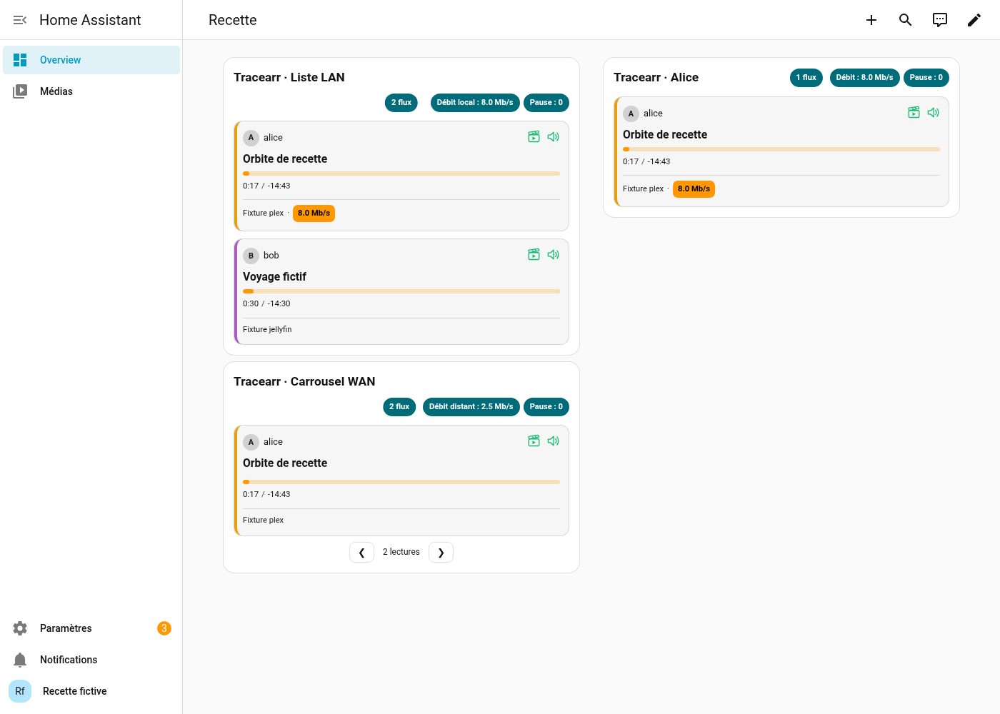
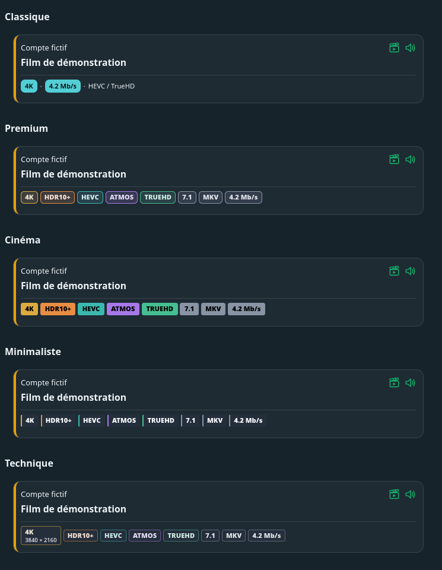

# Tracearr HA

**Voyez qui regarde quoi sur Plex, Jellyfin et Emby, directement dans Home Assistant.** Tracearr HA utilise les données de Tracearr pour alimenter des capteurs et deux cartes Lovelace personnalisables : une vue d’ensemble des lectures et une carte centrée sur une seule lecture.

**Stable recommandée via HACS : [`v0.1.18`](https://github.com/Moosketair/home-assistant-tracearr/releases/tag/v0.1.18).** Voir [les nouveautés et les instructions de mise à jour](CHANGELOG.md#0118--2026-11-27).

[Voir les cartes](#aperçu-des-cartes) · [Installer](#installation-via-hacs) · [Configurer les cartes](docs/CONFIGURATION.md) · [Historique](CHANGELOG.md)

## Aperçu des cartes

*Aperçu du rendu classique dans Home Assistant, avec des données fictives.*

| Carte | Usage |
| --- | --- |
| **Lectures groupées** — `custom:tracearr-streams-card` | Les lectures en cours dans une liste ou un carrousel, avec filtres. Navigation tactile, au clavier et à la souris ; flèches, transitions et défilement automatique facultatifs. |
| **Lecture individuelle** — `custom:tracearr-stream-card` | Une seule lecture : la plus récente, ou une lecture ciblée par compte, serveur ou session. |

## Fonctionnalités et personnalisation

- **Suivi en direct.** Les lectures se mettent à jour en temps réel lorsque le flux d’événements SSE est disponible. Sinon, une récupération périodique prend le relais ; si les données restent périmées, les cartes le signalent.
- **Capteurs Home Assistant.** Nombre de flux, lectures directes ou transcodées, types de transcodage, débit estimé et disponibilité des serveurs. Testez les capteurs avant de les utiliser dans des automatismes critiques.
- **Mise en page et affichage.** Taille pilotée par les réglages natifs de *Sections*, mode compact, fond cinéma flouté, couleurs par type de serveur, affiches, avatars, titres et épisodes. Affichez la progression, le temps restant ou une estimation de fin.
- **Bandeau au choix.** Combinez statistiques Tracearr et entités Home Assistant, avec ordre, alignement et couleurs configurables. Filtrez l’affichage des débits à partir de vos [règles LAN/WAN](docs/CONFIGURATION.md#débits-locaux-et-distants).

### Nouveautés de la version 0.1.18

Les panneaux de lecture proposent cinq styles de badges techniques : **Classique** (rendu historique par défaut), **Premium** (fond teinté et bordure colorée), **Cinéma** (couleur pleine), **Minimaliste** (trait latéral) et **Technique** (précisions sur les formats). L’éditeur permet de prévisualiser le résultat, de choisir une disposition compacte ou séparée et de régler les couleurs, l’ordre et la visibilité des catégories. Selon les données disponibles, affichez la destination seule ou la comparaison source → destination.

Comparer les cinq styles (thème sombre)

*Comparaison issue du banc de recette, avec un compte et un film fictifs.*

Le temps restant reste visible à gauche pendant la pause et **En pause** s’affiche à droite. Les badges du bandeau peuvent avoir une couleur normale propre, distincte de leur couleur à zéro. Dans *Sections*, les cartes s’ajustent à leur contenu par défaut : un bandeau seul tient sur une ligne native si son contenu le permet. Les tailles explicitement enregistrées restent prioritaires.

[Réglages des badges techniques](docs/CONFIGURATION.md#badges-techniques-des-panneaux-de-lecture) · [Notes de la version 0.1.18](CHANGELOG.md#0118--2026-11-27)

## Installation via HACS

1. Dans **HACS**, recherchez **Tracearr HA** dans le catalogue et cliquez sur **Télécharger**.
2. **Redémarrez Home Assistant** après l’installation ou la mise à jour.

### Configuration initiale

1. Dans Home Assistant, ouvrez **Paramètres → Appareils et services → Ajouter une intégration → Tracearr HA**.
2. Renseignez l’adresse de votre serveur Tracearr et une clé API publique créée dans **Tracearr → Paramètres → Données et API → API**.
3. Dans votre tableau de bord, choisissez **Modifier → Ajouter une carte**, recherchez **Tracearr** et sélectionnez la carte groupée ou individuelle. L’éditeur visuel permet de choisir un compte ou un serveur sans saisir son identifiant.

Pour une mise à jour normale, conservez l’entrée et les cartes existantes. Après le redémarrage, actualisez le tableau de bord (`Ctrl + F5` si l’ancienne interface persiste, ou rechargez la page sur mobile). En mode ressources Lovelace YAML, [actualisez manuellement la version de la ressource](docs/CONFIGURATION.md#ressource-lovelace-en-mode-yaml).

## Compatibilité

- **Home Assistant 2025.6 ou ultérieur.**
- **Tracearr** doit fournir les routes REST requises de l’API publique v2. Voir les [détails de compatibilité Tracearr](docs/CONFIGURATION.md#compatibilité-tracearr) et la portée des vérifications par version.
- **Plex, Jellyfin et Emby** sont suivis via Tracearr ; l’intégration ne se connecte pas directement aux serveurs multimédias.
- **Chromium et Firefox** ont été testés. **Safari** n’a pas fait l’objet d’une validation spécifique.

## Limites actuelles

- **LAN/WAN :** la classification des lectures repose sur des règles manuelles par compte ou appareil. Tracearr HA ne déduit pas automatiquement la localisation d’un flux.
- **Arrêt à distance :** l’intégration ne permet pas d’arrêter une lecture.
- **Métadonnées :** la précision et la disponibilité des informations techniques dépendent des données que Tracearr transmet. Elles peuvent être incomplètes ou différées.
- **Musique :** l’affichage dédié aux lectures musicales n’est pas inclus ; il reste prévu dans le [lot 6C](docs/ROADMAP.md#lot-6c--lectures-musicales).

## Documentation et dépannage

- [Guide de configuration](docs/CONFIGURATION.md) : éditeur visuel, [exemples YAML](docs/CONFIGURATION.md#exemples-de-cartes-lovelace), badges et filtres.
- [Historique des versions](CHANGELOG.md) : nouveautés de la stable, notes des préversions et versions précédentes. [Versions publiées sur GitHub](https://github.com/Moosketair/home-assistant-tracearr/releases).
- [Maintenance](docs/MAINTENANCE.md) : distribution HACS, icônes et marque.

Dépannage rapide

- **Aucun capteur :** vérifiez l’adresse Tracearr, la clé API et **Paramètres → Système → Journaux**.
- **Clé refusée sur une intégration existante :** utilisez la demande de réauthentification de Home Assistant pour remplacer la clé sans recréer l’entrée ni perdre ses entités ou réglages.
- **Carte absente ou ancienne interface :** dans **Paramètres → Tableaux de bord → Ressources**, vérifiez l’unique module `/tracearr_ha/tracearr-card.js` avec `?v=` suivi de la version installée (par exemple `?v=0.1.18`). Redémarrez Home Assistant et rechargez le tableau de bord. En [mode YAML](docs/CONFIGURATION.md#ressource-lovelace-en-mode-yaml), vérifiez la déclaration manuelle.
- **Affiche absente :** vérifiez que Tracearr transmet une URL d’affiche et consultez les erreurs réseau ou les journaux. Sans affiche, le fond cinéma reste uni et sombre.
- **Carrousel immobile :** vérifiez le nombre de flux visibles, les réglages de défilement automatique, les préférences d’animation et la pause au survol.

## Contribution

Pour [signaler un problème ou proposer une amélioration](https://github.com/Moosketair/home-assistant-tracearr/issues), indiquez les versions de Home Assistant, Tracearr et Tracearr HA, le navigateur et les étapes pour reproduire le problème. Masquez les clés API, les URL signées et les données personnelles dans les journaux et captures. Pour contribuer au code, consultez le [guide de développement](docs/DEVELOPMENT.md).

**Licence MIT.** Projet communautaire indépendant, sans affiliation ni approbation officielle de Tracearr, Home Assistant, Plex, Jellyfin ou Emby. Son icône est une création distincte.
